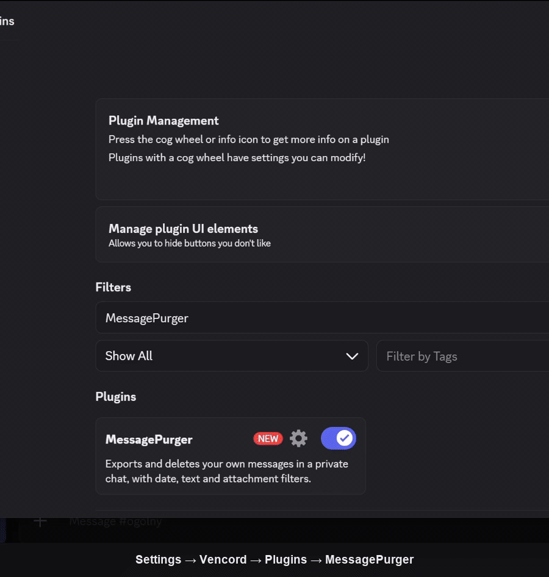

# MessagePurger

[](https://github.com/HajiLight/messagepurger/actions/workflows/ci.yml)
[](LICENSE)

A [Vencord](https://vencord.dev) userplugin that deletes **your own** messages in a private chat or a server text channel — filtered by date, text, or attachments, paced like a human, with an optional backup export first.

> [!CAUTION]
> **Use at your own risk:** Automating bulk message deletion on a user account is treated as automation/self-botting under Discord's Terms of Service and can result in **account suspension or IP bans**. Built-in pacing, the `401`/`403` circuit breaker, and captcha abort reduce accidental bursts, **but cannot guarantee your account will not be flagged or banned**. Not affiliated with or endorsed by Discord or Vencord.

> **v1.0.1** — tested with Discord Stable `1.0.9269` and Vencord `1.15.19`. Deletion touches only your own messages and requires a two-step confirmation.

## Demo



*Settings, preview, two-press confirmation, and post-run verification (`Verified: nothing of yours matching that range is left`).*

## Safety & scope

| Behaviour | Rule |
| --- | --- |
| **Targets** | 1:1 DMs (by user ID or channel ID; a user ID resolves only if the DM already exists) and server text channels; group DMs and threads are explicitly refused |
| **Deletion scope** | Only your own messages. Voice and video call records (Discord message type `3`, or a message carrying a call marker) are skipped without a delete request and reported separately; they remain in the chat. Everything else is attempted regardless of type. See [docs/message-types.md](docs/message-types.md) for the measurement. `429` is retried up to 3×; other `4xx` are final (`403` counts as refused, `404` as already gone) |
| **Permanent & visible** | Deletions are irreversible and vanish for everyone in the chat |
| **Two-step confirmation** | First `Start` arms and prints the exact delete count; second `Start` confirms (`1.5 s` anti-double-click guard; `60 s` window stamped to chat, cap, mode, filters, and `excludePinned`) |
| **Pinned messages** | Deleted by default; `excludePinned` skips pins **as read at preview time** — a pin added after the preview is still deleted, a pin removed after it is still skipped. Backups keep pins only if they pass the text/attachment filters |
| **Post-run verification** | `verifyAfterRun` (default `true`) re-reads the range to verify leftovers and reports withheld caps, kept pins and call records left in the range; transport/5xx errors retry once before verification |
| **Circuit breakers** | Aborts immediately on HTTP `400` `captcha_key` or 3 consecutive `401`/`403` responses; `Stop` cancels sleeps and stops paging after the in-flight page |

## Backup

Because reading history is required anyway, **Export JSON + TXT** (or `Export only` / `Export, then delete`) is nearly free:

- **Formats:** `messages-<chat>-<range>.jsonl` (structured per-message JSON including attachment URLs and embed count) and `messages-<chat>-<range>.txt` (readable log without URLs).
- **Both authors, filtered snapshot:** backups contain every message that matches the filters from both sides, as read at preview time; only deletion filters by author. They are not a live archive: later messages and edits are absent.
- **Known limits:** Discord opens two OS Save dialogs (the panel reports **offered**, not saved — verify both files exist before confirming deletion). Exports have no channel-ID field, but JSONL attachment URLs embed channel and message IDs — treat exports as private. Also omitted: filter metadata, embed bodies, stickers, polls, reactions, and binary attachments (Discord CDN attachment URLs expire in ~24 hours). Call records are included as empty-content entries when they pass the filters; their message type is not serialized.

## Rate limits & defaults

Private chats cannot use bulk-delete, so the plugin paces against Discord's slowest documented `DELETE` bucket (`5 per 5 s`) and guards against Cloudflare's `10,000 invalid requests / 10 min` IP-ban ceiling. See [`docs/rate-limits.md`](docs/rate-limits.md) for details.

| Setting | Default | Purpose |
| --- | --- | --- |
| `baseDelayMs` | `1400 ms` (±40% jitter) | Averages ~0.71 req/s before pauses (`600 ms` base floor; `4000 ms` base cap, jitter sits on top; `429` backoff can raise it further) |
| Long pause | `6–18 s` every `15–30` deletes | Brings sustained rate to ~0.5 req/s (~2.2 s/msg overall) |
| History paging | `600–1200 ms` / page | Retries `429` up to 3× with backoff (`fetchWindow` and `deleteMessage`) |
| `runCap` | `300` (`300` / `1000` / `3000` / `0`) | Bounds blast radius per run; backups are never capped |

## Install

Requires Node.js 22+, pnpm, Git, and Vencord built from source:

```bash
git clone https://github.com/Vendicated/Vencord.git
cd Vencord
pnpm install --frozen-lockfile
git clone https://github.com/HajiLight/messagepurger.git src/userplugins/messagePurger
pnpm build
pnpm inject
```

1. Quit Discord completely (tray icon included) and restart it.
2. Enable **MessagePurger** in **Settings → Vencord → Plugins**.
3. **Vesktop:** skip `pnpm inject`, point **Vesktop Settings → Developer Settings → Vencord Location** at Vencord's `dist` folder, then fully restart Vesktop.

**Modes:** `Export, then delete` (default; the first `Start` offers the two backup files before arming), `Export only`, and `Delete only` (no backup).

## Development

```bash
pnpm install
node scripts/dev.mjs            # copy into Vencord ($VENCORD_DIR, ./.vencord, ../Vencord, ../vencord/Vencord)
node scripts/dev.mjs --build    # copy, build, and verify MessagePurger is in dist/renderer.js
pnpm check                      # type check (skipped cleanly if Vencord is absent) + unit tests
```

`core.ts` is pure (no Vencord, DOM, or network imports); Discord API access lives in `discord.ts`, and UI/orchestration in `index.tsx`.

## Project

- [Security policy](SECURITY.md)
- [Contributing](CONTRIBUTING.md)
- [Changelog](CHANGELOG.md) — every released version
- [Releases](https://github.com/HajiLight/messagepurger/releases) — release notes and downloads
- [Issues](https://github.com/HajiLight/messagepurger/issues) — bug reports and feature requests

## License

[GPL-3.0-or-later](LICENSE), matching Vencord.
